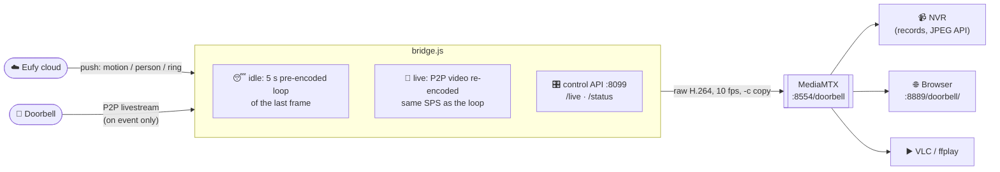

<div align="center">

# 🔔 eufy-bridge

**Turn a Eufy battery doorbell into an always-on RTSP camera — that only wakes up when there's something to see.**


[How it works](#-how-it-works) ·
[Quick start](#-quick-start) ·
[Configuration](#-configuration) ·
[Control API](#-control-api) ·
[Shinobi](#-shinobi) ·
[Live on demand](#-live-on-demand) ·
[Traps](#-traps-found-on-the-way)

</div>

---

Eufy's battery doorbells (tested: **T8214**, Wi-Fi direct, no HomeBase) have **no RTSP
or local stream of any kind**: the only open port is Eufy's P2P protocol on UDP 32108.
NVRs such as Shinobi (and anything that reads from Shinobi, like Frigate) can't use them.

**eufy-bridge** logs into Eufy with a second account, opens the P2P livestream **only on
events or while someone is watching**, and turns that into **one RTSP stream that never
stops**.

## ✨ Highlights

| | |
|---|---|
| 📼 **One unbroken stream** | Between events: a dimmed, blurred loop of the last frame labelled *"idle - last live HH:MM"*. During events: the real video. Your NVR just sees a camera that's always there. |
| 🪄 **Seamless switching** | Idle loop and live video share a byte-identical SPS, every switch lands on an IDR, and one 10 fps clock paces both — so the muxer only ever does `-c copy`. |
| 🔋 **Battery-friendly** | The doorbell streams only on motion / person / ring, a manual `/live`, an optional refresh, or while a viewer holds it open. |
| 👀 **Live on demand** | An nginx `mirror` wakes the doorbell when someone opens the *video* stream; the JPEG snapshot stays free. |
| 🪶 **Lightweight** | ~0.2% of one core and 28 kbps while idle. |
| 🐳 **Docker or bare metal** | `docker compose up -d` or two shell launchers. |

## 🧭 How it works



- **One unbroken stream.** NVRs expect a camera that never goes away. Between events
  the bridge replays a placeholder loop; during an event it sends the real video.
  Both are cut on access-unit boundaries, every switch lands on an IDR, and one 10 fps
  clock paces both, so the muxer only ever does `-c copy` and the timestamps are
  constant-rate.
- **The switch is invisible to the decoder.** The idle loop and the live re-encode
  share an identical SPS (800x1100, Main 4.0, no B-frames; checked byte for byte).
  Only GOP and CRF differ, which changes the PPS, and the PPS is resent with every IDR.
- **Battery.** The doorbell streams only for `LIVE_SECONDS` (45) after the last event,
  during a manual `/live`, for an optional periodic refresh (`REFRESH_MINUTES`), or
  while a viewer holds it open (see [Live on demand](#-live-on-demand)). The library's
  default 30 s livestream cap is turned off; the bridge stops the stream itself.

## 📋 Requirements

- A **second Eufy account** that the doorbell is shared to (see below)
- **Docker** — or, to run without it:
  - Node.js 20+
  - `ffmpeg` with libx264
  - The DejaVu Sans Bold font at `/usr/share/fonts/truetype/dejavu/DejaVuSans-Bold.ttf`
    (Debian/Ubuntu: `fonts-dejavu-core`), for the idle-loop label
  - [MediaMTX](https://github.com/bluenviron/mediamtx) (tested with v1.15.3). It is not
    vendored; `bin/run-mediamtx` has the download command.

## 🚀 Quick start

### 1. Make a bridge account

Create a second Eufy account. In the main account's app, **share the doorbell to it**.
The bridge accepts the invite on its own.

> [!WARNING]
> Do not use your main account: the bridge's login would keep signing the phone out.

### 2a. Run with Docker (recommended)

`compose.yml` runs the bridge and MediaMTX as two containers, both on host networking
(the P2P link finds the doorbell by LAN broadcast, and WebRTC needs real host addresses):

```bash
cp eufy-bridge.env.example eufy-bridge.env && chmod 600 eufy-bridge.env   # fill in
mkdir -p state && sudo chown 1000:1000 state && chmod 700 state
docker compose up -d --build
```

Ports on the host: `8099` (control API), `8554` (RTSP), `8888` (HLS), `8889` (WebRTC
page), `8189/udp` (WebRTC media), `8000-8001/udp` (RTSP over UDP). Nothing in the bridge
needs HLS: set `MTX_HLS=no` in `.env` if 8888 is taken.

> [!TIP]
> Moving an existing install? Copy its `persistent.json` into `state/` first, with the
> same `EUFY_TRUSTED_DEVICE`, so Eufy sees the same device and does not ask for a new
> login code. Stop the old bridge before starting the new one: two bridges on one
> account sign each other out.

### 2b. Run without Docker

1. **Credentials** in `~/.config/eufy-bridge/env`, mode 0600:
   ```bash
   EUFY_USER=bridge-account@example.com
   EUFY_PASS=...
   ```
2. **Install:** `npm ci`, plus the MediaMTX binary in `~/.local/opt/mediamtx/`.
3. **Run** `bin/run-mediamtx` and `bin/run-bridge`.

### 3. First login

Eufy may email a code: write it to `tfa-code` in the state folder
(`~/.local/state/eufy-bridge/`, or `state/` with Docker) and the bridge picks it up.
If Eufy asks for a captcha instead, the bridge saves it as `captcha.png` in the same
folder and logs where.

### 4. Check it

```bash
curl -s http://<bridge-host>:8099/status
```

Then open `http://<bridge-host>:8889/doorbell/` in a browser, or point VLC at
`rtsp://<bridge-host>:8554/doorbell`. 🎉

> [!NOTE]
> `npm run probe` (with the env loaded) logs in read-only and prints what the account
> sees: pending share invites, devices, and battery.

## 🔧 Configuration

All settings come from the environment; `bin/run-bridge` loads
`~/.config/eufy-bridge/env` (or the file named by `EUFY_BRIDGE_ENV`), Docker uses
`eufy-bridge.env`.

| Variable | Default | What |
|---|---|---|
| `EUFY_USER`, `EUFY_PASS` | (required) | the second Eufy account |
| `EUFY_COUNTRY` | `US` | Eufy account country |
| `EUFY_DEVICE_SN` | first doorbell found | serial of the device to bridge, if the account sees several |
| `EUFY_TRUSTED_DEVICE` | `eufy-bridge` | the name Eufy shows for this login |
| `LIVE_SECONDS` | `45` | how long an event keeps the stream live |
| `REFRESH_MINUTES` | `0` (off) | wake the doorbell for 10 s once the idle frame is this old, so the placeholder stays recent; every wake costs battery |
| `REFRESH_HOURS` | `0-23` | local hours the refresh runs in, e.g. `7-19` for daytime only |
| `TZ` | system | local time for `REFRESH_HOURS` and the idle-loop clock label |
| `RTSP_URL` | `rtsp://127.0.0.1:8554/doorbell` | where the bridge publishes |
| `CONTROL_PORT` | `8099` | control API port |
| `STATE_DIR` | `~/.local/state/eufy-bridge` | session tokens, last frame, idle loop |

Runtime files, all outside the repo:

| Path | What |
|---|---|
| `~/.config/eufy-bridge/env` (0600) | credentials and settings |
| `~/.local/state/eufy-bridge/` (0700) | Eufy session tokens (`persistent.json`), `last.jpg`, the idle loop, `tfa-code` / `captcha.png` during login |

## 🕹 Control API

| Request | Effect |
|---|---|
| `GET /status` | JSON: mode (`idle`/`live`), live-until, live sessions, underflows, last event, `lastLive` (epoch ms of the last real picture), and `cloudConnected` / `pushConnected` (logged in, and event triggers armed: a monitor should alert on either being false) |
| `GET /live?s=60` | go live now for `s` seconds (5-600, default 60) |
| `GET /live?s=60&reason=viewer` | same, tagged with a reason (`[a-z-]{1,20}`) in `/status` and the log |

> [!CAUTION]
> The API has no authentication: keep port 8099 on a trusted network.

## 📹 Shinobi

`shinobi/doorbell_monitor.py` creates the Shinobi monitor. It runs **on the Shinobi
host as root**, reads the group's admin API key from Shinobi's `ccio` database and
talks to Shinobi on localhost, so the key never leaves the host and is never printed.
It clones an existing plain RTSP record-mode monitor as the template:

```bash
# for example via Ansible:
ansible shinobi -b -m ansible.builtin.script \
  -a "shinobi/doorbell_monitor.py --group <group> --template <monitor-id> apply rtsp://<bridge-host>:8554/doorbell"
```

| Command | What |
|---|---|
| `apply <rtsp_url>` | create or update monitor `doorbell` from the template and turn its JPEG API on |
| `check` | status, newest recordings, one snapshot to `/tmp/doorbell-snap.jpg` |
| `grab [out.jpg]` | one frame from Shinobi's own HLS output |
| `inspect` | the template's source settings, credentials redacted |
| `remove` | delete the monitor (recordings stay on disk) |

The JPEG is then at `https://<shinobi-host>/<apiKey>/jpeg/<group>/doorbell/s.jpg`:
portrait, 800x1100, two views stacked (street on top, package camera below), showing
the idle placeholder except during events. When the bridge restarts, Shinobi loses
the stream and reconnects by itself in ~13 s.

## 👀 Live on demand

*A viewer opening the stream wakes the doorbell.*

An nginx `mirror` on the Shinobi vhost can wake the doorbell whenever someone opens
its **video** stream, while the JPEG stays cheap. A client that shows the JPEG and
switches to the stream when the user taps "live" then wakes the doorbell with no
change on its side:

```nginx
# HLS and embed are polled every few seconds: each poll asks for 60 s more.
location ~ ^/[^/]+/(hls|embed)/<group>/doorbell/ {
    mirror /_doorbell_live_poll;
    proxy_pass http://127.0.0.1:8080;   # Shinobi; keep your usual proxy headers here
    proxy_buffering off;
}
location = /_doorbell_live_poll {
    internal;
    proxy_pass http://<bridge-host>:8099/live?reason=viewer&s=60;
    proxy_method GET;
    proxy_pass_request_body off;
    proxy_set_header Content-Length "";
    proxy_connect_timeout 2s;
    proxy_read_timeout 5s;
}
# Repeat for (mp4|flv|h265|mjpeg) with s=300: one long request, so it asks once.
```

| Request | Effect |
|---|---|
| `/<key>/jpeg/<group>/doorbell/s.jpg` | nothing |
| `/<key>/hls/<group>/doorbell/s.m3u8`, `/embed/...` | +60 s per request; live lasts while someone watches and ends 60 s after the last poll |
| `/<key>/mp4\|flv\|h265\|mjpeg/...` | +300 s once. A viewer who keeps watching past that sees the idle loop until they reconnect |

Measured: first HLS request → live picture **1.3 s**; last poll → back to idle 60 s.
The first segments a viewer gets are still the idle loop (Shinobi's HLS lags a few
seconds).

> [!WARNING]
> The mirror fires before Shinobi checks the API key, so any request on that path
> wakes the doorbell: keep nginx LAN-only.

## 📊 Measured

*Ryzen 5 4600G, 2026-10-16*

| | Value |
|---|---|
| Idle CPU | ~0.2% of one core (replaying the loop; it is encoded once per event, ~5 s CPU) |
| Live CPU | ~21-26% of one core, only during events |
| Idle on the wire / on the NVR's disk | 28 kbps, ~0.3 GB/day |
| Live | ~1.4 Mbps, ~8 MB per 45 s event |
| Event → live picture | Eufy push arrives 1-10 s after the person, then ~1.5 s to picture (P2P start ~1 s + encoder ~0.5 s) |
| Shinobi | records with `-c copy`, 0.2% CPU; 15-min files match the source exactly (H.264 Main 4.0, 800x1100, 10/1 CFR, duration = wall clock, 0 decode errors) |

## 🪤 Traps found on the way

<details>
<summary><b>Shinobi stores <code>snap: "1"</code> as the number <code>1</code></b></summary>

…when saved through `configureMonitor`, but only builds the JPEG output for the string
`'1'`. A cloned monitor therefore had no JPEG API. `doorbell_monitor.py apply` sets it
in the DB and cycles the monitor stop → record, which reloads from the DB.
</details>

<details>
<summary><b>Shinobi's restricted API keys cache their camera list</b></summary>

…until `pm2 restart camera` (~40 s gap on every camera). A new monitor is invisible to
those keys until then; full-access keys see it at once.
</details>

<details>
<summary><b>Eufy device type 94 / T8214 is dual-camera</b></summary>

One 1600x2200 picture, two views stacked. Its stream resolution changes on its own
(seen 1024x1408); the live re-encode scales everything to 800x1100, so consumers never
see that.
</details>

<details>
<summary><b>Raw H.264 with wallclock timestamps gave non-monotonic DTS</b></summary>

The live encoder emits in bursts. Hence the single 10 fps clock with a 5-AU prebuffer.
</details>

<details>
<summary><b>x264's default threading and lookahead held ~3 s of frames</b></summary>

…before the live encoder emitted anything, and ffmpeg's input probe ~1 s more. The live
encoder runs `-threads 2`, `rc-lookahead=0` and no probe. `-tune zerolatency` would be
faster still, but it changes one SPS bit and breaks the matching SPS.
</details>

<details>
<summary><b>A Eufy account share brings every camera on the account</b></summary>

The bridge picks the first doorbell; set `EUFY_DEVICE_SN` to pick another device.
</details>

<details>
<summary><b>Don't feed Frigate the doorbell from Shinobi's HLS</b></summary>

With the viewer hook in place, Frigate polls forever, so the doorbell would stream
24/7. Point Frigate at `rtsp://<bridge-host>:8554/doorbell` instead.
</details>

## 🚧 Limitations

- **eufy-security-client is deprecated** (repo archived 2026-09-12; development moved
  to [`@mega-yfue/eufy-sdk`](https://github.com/mega-yfue/eufy-sdk), same maintainers,
  new API, Node >= 24.5). This bridge stays pinned to `4.1.1-1`, which works, but
  nobody will fix it when Eufy changes their cloud or P2P protocol. Porting means
  rewriting the Eufy layer of `bridge.js` (login, captcha/2FA, device pick, push events,
  livestream start/stop and its video data); the video pipeline does not change.
  Port when the pin breaks, or once eufy-sdk is shown to stream a battery doorbell's
  P2P livestream.
- Without Docker, the launchers are plain processes: nothing restarts them after a
  reboot. Wrap them in a service manager (systemd, ...) if you rely on the stream.
  The compose deployment restarts on its own (`restart: unless-stopped`).
- Event-triggered live has mostly been driven by `/live` and the viewer hook; a real
  motion/ring trigger has not been watched end to end.
- No audio, and no ring events forwarded anywhere (Home Assistant users want
  `eufy_security_ws` for that).
- Untested: passing the doorbell's H.264 straight through (zero CPU). It would need an
  idle loop that matches the doorbell's own SPS, while that resolution changes on its
  own.

## 📁 Layout

| Path | What |
|---|---|
| `bridge.js` | the bridge |
| `mediamtx.yml` | RTSP/WebRTC server config |
| `bin/run-bridge`, `bin/run-mediamtx` | launchers, for running without Docker |
| `Dockerfile`, `compose.yml`, `eufy-bridge.env.example` | the container deployment |
| `shinobi/doorbell_monitor.py` | create/check/remove the Shinobi monitor; runs on the Shinobi host |
| `tools/probe-account.js` | read-only: what the Eufy account sees (invites, devices, battery) |

---

<div align="center">

Built on [eufy-security-client](https://github.com/bropat/eufy-security-client) ·
streamed by [MediaMTX](https://github.com/bluenviron/mediamtx)

</div>
